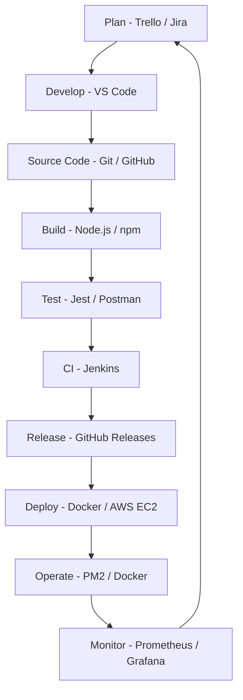

# 🏠 Hostel Management System

A simple **Hostel Management System** developed using **HTML, CSS, JavaScript, Node.js, and Express.js**. The application helps hostel administrators manage students, room allocation, fees, complaints, feedback, and hostel information through an easy-to-use web interface.

This project also demonstrates the implementation of the **DevOps Lifecycle**, including planning, development, source code management, building, testing, continuous integration, containerization, deployment, and monitoring.

---

# 📖 Project Overview

The Hostel Management System is designed to simplify hostel administration by providing a centralized platform for managing student records and hostel activities.

It includes separate access for **Admin and Student users**, allowing role-based access to hostel management features.

---

# ✨ Features

### 🔐 Authentication
- Admin Login
- Student Login
- Role-based access control

### 👨‍🎓 Student Management
- Register new students
- View student details
- Delete student records
- Maintain student information

### 🛏️ Room & Bed Allocation
- Automatic room allocation
- Bed assignment
- Occupancy tracking

### 💰 Fee Management
- Record fee payments
- Display paid and pending fees
- Payment status monitoring

### 📝 Complaint Module
- Students can submit complaints
- Admin can manage complaints

### 💬 Feedback Module
- Submit feedback
- Store suggestions
- Display student feedback

### 🏢 Hostel Facilities
- WiFi
- Security
- Study Room
- Hot Water
- Washing Machine

### 🍽️ Menu & Timings
- Weekly food menu
- Breakfast timing
- Lunch timing
- Dinner timing
- Hostel gate timings

### 📢 Notice Board
- Fee reminders
- Maintenance notices
- Important announcements

### 📊 Dashboard
- Total students
- Available beds
- Occupied rooms
- Pending fees

---

# 🛠️ Technologies Used

| Technology | Purpose |
|---|---|
| HTML5 | Webpage structure |
| CSS3 | Styling and UI design |
| JavaScript | Frontend functionality |
| Node.js | Backend runtime |
| Express.js | Backend framework |
| Browser Local Storage | Client-side data storage |
| npm | Package management |

---

# 🔄 DevOps Lifecycle Implementation

The DevOps lifecycle is a continuous process that connects software development and operations. It helps developers build, test, deploy, and maintain applications efficiently.

The following DevOps stages are suitable for the Hostel Management System.

## 1. Plan – Project Planning

**Purpose:** Identify project requirements, features, tasks, and development activities.

**Activities:**
- Identify hostel management requirements.
- Divide the project into modules.
- Assign tasks to team members.
- Prepare a development schedule.

**Tools:**
- Trello – Task management.
- GitHub Projects – Project tracking.
- Jira – Agile project management.

**Project Example:** Planning authentication, student management, room allocation, fee management, and complaint modules.

## 2. Develop – Application Development

**Purpose:** Write the application source code and develop project features.

**Activities:**
- Develop HTML pages.
- Design interfaces using CSS.
- Implement JavaScript functionality.
- Develop backend APIs using Node.js and Express.js.

**Tools:**
- Visual Studio Code – Code editor.
- HTML5 – Frontend structure.
- CSS3 – Styling.
- JavaScript – Application logic.
- Node.js – Backend development.
- Express.js – API development.

**Project Example:** Developing the Admin Dashboard and Student Login functionality.

## 3. Source Code Management – Version Control

**Purpose:** Maintain source code versions and track changes made by developers.

**Activities:**
- Create a Git repository.
- Push source code to GitHub.
- Create feature branches.
- Commit code changes.
- Merge completed features into the main branch.

**Tools:**
- Git – Version control.
- GitHub – Remote repository.
- GitHub Desktop – Graphical Git management.

**Project Example:**

```bash
git init
git add .
git commit -m "Initial Hostel Management System"
git branch -M main
git remote add origin YOUR_GITHUB_REPOSITORY_URL
git push -u origin main
```

## 4. Build – Application Build

**Purpose:** Install dependencies and prepare the application for execution.

**Activities:**
- Install Node.js dependencies.
- Configure package.json.
- Verify application scripts.
- Prepare the application for deployment.

**Tools:**
- npm – Dependency management.
- Node.js – Application runtime.
- package.json – Project configuration.

**Commands:**

```bash
npm install
npm start
```

**Project Example:** Installing Express.js and starting the Hostel Management System server.

## 5. Test – Software Testing

**Purpose:** Verify that the application works correctly and identify errors before deployment.

**Activities:**
- Test Admin Login.
- Test Student Login.
- Test student registration.
- Test room allocation.
- Test fee management.
- Test complaint submission.
- Test backend APIs.

**Tools:**
- Jest – JavaScript unit testing.
- Supertest – Express API testing.
- Postman – API testing.
- Chrome Developer Tools – Frontend debugging.

**Project Example:** Checking whether students can log in and submit complaints successfully.

*Note: Jest and Supertest can be added when automated tests are implemented.*

## 6. Continuous Integration (CI)

**Purpose:** Automatically build and test the application whenever developers push code changes.

**Activities:**
- Connect GitHub with Jenkins.
- Configure a Jenkins pipeline.
- Pull the latest source code.
- Install dependencies.
- Execute automated tests.
- Report build results.

**Tools:**
- Jenkins – CI automation.
- GitHub – Source code repository.
- npm – Dependency installation.
- Jest – Automated testing.

**Project Example:** Whenever a developer pushes updated Hostel Management System code to GitHub, Jenkins automatically starts the pipeline.

## 7. Release – Version Management

**Purpose:** Prepare a tested application version for deployment.

**Activities:**
- Verify successful testing.
- Create release versions.
- Tag stable versions.
- Prepare deployment artifacts.

**Tools:**
- Git Tags – Version management.
- GitHub Releases – Release management.
- Jenkins – Release automation.

**Example:**

```bash
git tag v1.0
git push origin v1.0
```

## 8. Deploy – Application Deployment

**Purpose:** Deploy the application so users can access it through a browser.

**Activities:**
- Create a Docker image.
- Test the container locally.
- Push the image to a container registry.
- Deploy the application on a server.

**Tools:**
- Docker – Application containerization.
- Docker Hub – Docker image registry.
- AWS EC2 – Cloud deployment.
- Render – Alternative application hosting.

**Example Docker commands:**

```bash
docker build -t hostel-management .
docker run -d -p 3000:3000 hostel-management
```

**Project Example:** Running the Hostel Management System inside a Docker container.

## 9. Operate – Application Operations

**Purpose:** Ensure the deployed application runs properly.

**Activities:**
- Start and stop application services.
- Manage application processes.
- Configure environment variables.
- Restart the application when necessary.

**Tools:**
- PM2 – Node.js process management.
- Docker – Container management.
- Linux – Server administration.

**Project Example:** Using PM2 to keep the Hostel Management System backend running on the server.

## 10. Monitor – Application Monitoring

**Purpose:** Monitor application performance, availability, and errors.

**Activities:**
- Monitor server status.
- Check application logs.
- Identify errors.
- Monitor resource usage.
- Track application availability.

**Tools:**
- Jenkins – Pipeline monitoring.
- Docker logs – Container log monitoring.
- Prometheus – Metrics collection.
- Grafana – Monitoring dashboards.

**Project Example:** Monitoring the backend application and identifying server errors.

---

# 🔁 DevOps Lifecycle Diagram

The following diagram represents the DevOps workflow for this project.



---

# 🧰 DevOps Tools Summary

| DevOps Stage | Recommended Tools |
|---|---|
| Plan | Trello, Jira |
| Develop | VS Code, Node.js |
| Source Code Management | Git, GitHub |
| Build | npm, Node.js |
| Test | Jest, Postman, Supertest |
| Continuous Integration | Jenkins |
| Release | Git Tags, GitHub Releases |
| Deploy | Docker, Docker Hub, AWS EC2 |
| Operate | PM2, Docker |
| Monitor | Prometheus, Grafana |

---

# 📁 Project Structure

```text
Hostel-Management-System/
│
├── README.md
├── package.json
├── package-lock.json
├── server.js
│
├── public/
│   ├── login.html
│   ├── dashboard.html
│   ├── bus.jpg
│   ├── food.jpg
│   ├── hostel.jpg
│   ├── mess.jpg
│   ├── room.jpg
│   └── wifi.jpg
│
├── tests/
│   └── app.test.js
│
├── Dockerfile
├── .dockerignore
├── Jenkinsfile
└── .gitignore
```

*Note: The tests, Docker, and Jenkins files are suggested additions for the DevOps implementation.*

---

# ⚙️ Installation and Execution

### 1. Clone the repository

```bash
git clone https://github.com/akshayagampa21-arch/Hostel-Management-System.git
```

### 2. Open the project folder

```bash
cd Hostel-Management-System
```

### 3. Install dependencies

```bash
npm install
```

### 4. Start the server

```bash
node server.js
```

or

```bash
npm start
```

### 5. Open in browser

```text
http://localhost:3000
```

---

# 🐳 Docker Implementation

Docker allows the Hostel Management System to run in an isolated container environment.

### Build Docker Image

```bash
docker build -t hostel-management .
```

### Run Docker Container

```bash
docker run -d -p 3000:3000 --name hostel-app hostel-management
```

### Check Running Containers

```bash
docker ps
```

### Stop Container

```bash
docker stop hostel-app
```

*Note: A suitable Dockerfile and a server configured to listen on the container's network interface must be added before executing these commands.*

---

# ⚙️ Jenkins CI Pipeline

Jenkins can automate the build and testing process whenever new code is pushed to GitHub.

### Pipeline Stages

1. Checkout – Download source code from GitHub.
2. Install Dependencies – Execute npm install.
3. Build – Prepare the application.
4. Test – Execute automated tests.
5. Report – Display pipeline success or failure.

**Tool:** Jenkins with a Jenkinsfile.

*Note: Configure GitHub integration, Jenkins, Node.js, and automated test scripts before enabling this pipeline.*

---

# 🔐 Security and Best Practices

- Use GitHub for source code management.
- Store passwords and API keys in environment variables.
- Avoid uploading `.env` files to GitHub.
- Use `.gitignore` for unnecessary files.
- Run `npm audit` to identify dependency vulnerabilities.
- Implement proper authentication and authorization.
- Use HTTPS for production deployment.
- Protect the main branch with code reviews.

---

# 🚀 Future Enhancements

- Database Integration (MySQL / MongoDB).
- Online Fee Payment.
- Student Profile Management.
- QR Code Based Attendance.
- Email Notifications.
- Report Generation.
- Mobile Responsive UI.
- Cloud Deployment.
- Automated CI/CD Pipeline.
- Application Monitoring and Logging.

---

# 👨‍💻 Author

**Akshaya Gampa**

Bachelor of Technology (B.Tech)

Computer Science and Engineering

---

# 📄 License

This project is developed for **academic and educational purposes**.

---

# ⭐ Acknowledgements

This project demonstrates web development, role-based authentication, hostel administration, CRUD operations, and the DevOps lifecycle using modern development and deployment tools.

The DevOps implementation aims to automate software development, testing, integration, deployment, and monitoring, making the Hostel Management System easier to maintain and improve.
